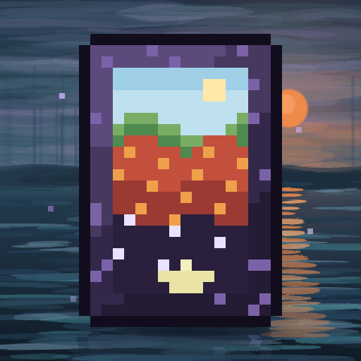

# MoreDimensions



An API for LeviLamina mods to add custom dimensions to Minecraft Bedrock Dedicated Server, using the vanilla
generator types or **native custom generators**.

**Note: MoreDimensions is a library and adds no dimensions by itself. Install it for mods that use its API.**

## Install

MoreDimensions requires LeviLamina 26.51.x.

Install with [lip](https://github.com/LiteLDev/lip):

```sh
lip install github.com/LiteLDev/MoreDimensions
```

## Usage

Wiki: [Chinese and English](https://github.com/LiteLDev/MoreDimensions/wiki)

## Quick Experience

You can download the [**test artifacts**](https://github.com/LiteLDev/MoreDimensions/actions/workflows/build.yml) in Action.

The test build creates seven dimensions: five with the vanilla generator types (`custom_dim:new_overworld_type`,
`custom_dim:new_flat_type`, `custom_dim:new_nether_type`, `custom_dim:new_theend_type` and `custom_dim:new_void_type`)
and two with custom generators (`custom_dim:new_flat_village_type` and `custom_dim:new_flat_custom_terrain`).

Use the commands provided by LeviLamina. You can enter these dimensions

```
tpdim ~ ~ ~ [dimension name]
```

About these dimensions, you can see it in https://github.com/LiteLDev/MoreDimensions/blob/develop/src/test/TestCustomDimension.cpp

## Contributing

Ask questions by creating an issue.

PRs accepted.

## License

LGPL-3.0-or-later © LeviMC
