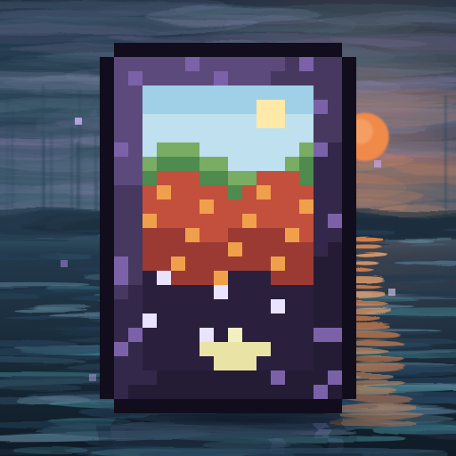

# MoreDimensions



An API for LeviLamina mods to add custom dimensions to Minecraft Bedrock Edition, on Bedrock Dedicated Server and on
the client (Minecraft for Windows), using the vanilla generator types or **native custom generators**.

**Note: MoreDimensions is a library and adds no dimensions by itself. Install it for mods that use its API.**

## Install

MoreDimensions runs on both the server (Bedrock Dedicated Server) and the client (Minecraft for Windows), and requires
LeviLamina 26.60.7 or later (below 26.61.0). Each release has a server and a client build; lip and LeviLauncher pick the
one for the side they install to.

Install with [lip](https://github.com/LiteLDev/lip):

```sh
lip install github.com/LiteLDev/MoreDimensions
```

## Usage

Wiki: [Chinese and English](https://github.com/LiteLDev/MoreDimensions/wiki)

## Quick Experience

You can download the [**test artifacts**](https://github.com/LiteLDev/MoreDimensions/actions/workflows/build.yml) (the ones ending in `-tests`) in Actions: the `server` one for Bedrock Dedicated Server, the
`client` one for Minecraft for Windows.

The test build creates seven dimensions: five with the vanilla generator types (`custom_dim:new_overworld_type`,
`custom_dim:new_flat_type`, `custom_dim:new_nether_type`, `custom_dim:new_theend_type` and `custom_dim:new_void_type`)
and two with custom generators (`custom_dim:new_flat_village_type` and `custom_dim:new_flat_custom_terrain`).

Use the commands provided by LeviLamina. You can enter these dimensions

```
tpdim ~ ~ ~ [dimension name]
```

About these dimensions, you can see it in https://github.com/LiteLDev/MoreDimensions/blob/develop/src/test/TestCustomDimension.cpp

## Contributing

Ask questions by creating an issue.

PRs accepted.

## License

LGPL-3.0-or-later © LeviMC
